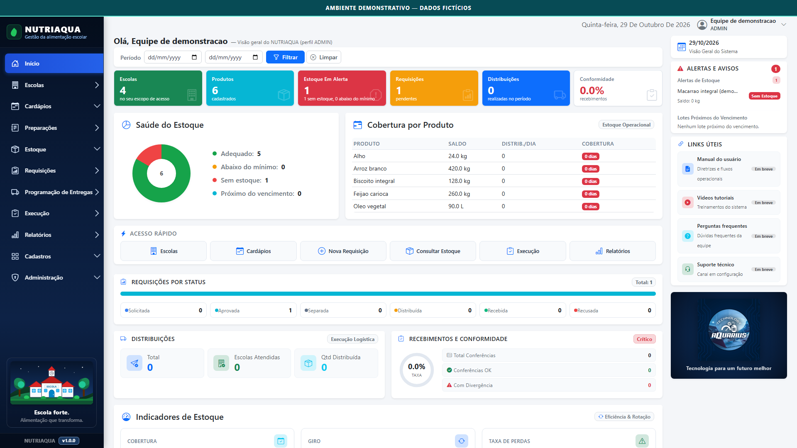

# NUTRIAQUA — Showcase Profissional

**Tecnologia para organizar a gestão da alimentação escolar.**

> **Estudo de caso independente:** este repositório contém somente a vitrine pública do projeto. O código-fonte operacional completo, os bancos reais, as credenciais e o ambiente de produção **não são publicados**.

## O projeto

O **NUTRIAQUA** é uma aplicação web de apoio aos processos de alimentação escolar: cadastros, planejamento, estoque e organização de guias para distribuição. Este portfólio apresenta o conceito, as principais telas e uma visão da arquitetura.

**NUTRIAQUA** é o produto; **Technology Aquarius** é a marca desenvolvedora; **Carlos Gomes** é o autor e desenvolvedor.

A apresentação não indica contratação, implantação ou endosso por qualquer órgão público.

## Demonstração

As seis capturas abaixo foram produzidas em ambiente local isolado, com informações fictícias e a identificação visual **AMBIENTE DEMONSTRATIVO — DADOS FICTÍCIOS**:

| Módulo | Captura |
| --- | --- |
| Painel de gestão | [Visualizar](assets/screenshots/01-painel.png) |
| Escolas | [Visualizar](assets/screenshots/02-escolas.png) |
| Produtos | [Visualizar](assets/screenshots/03-produtos.png) |
| Estoque | [Visualizar](assets/screenshots/04-estoque.png) |
| Planejamento de cardápios | [Visualizar](assets/screenshots/05-cardapio.png) |
| Guia de separação | [Visualizar](assets/screenshots/06-guia.png) |

**Tecnologias do software:** Python, Flask, HTML, Jinja2, Bootstrap e Pytest. A página de portfólio é estática (HTML/CSS/JavaScript), independente do software operacional.

**Arquitetura:** [explicação pública](docs/arquitetura.html), sem topologia de produção nem segredos.

## Vídeo demonstrativo

O [vídeo institucional silencioso (52 segundos)](assets/video/NUTRIAQUA-F10-52s.mp4) está integrado na [seção audiovisual do site](https://cg533317.github.io/nutriaqua-showcase/#video), com [descrição das cenas](docs/roteiro-video.html). Usa exclusivamente capturas com dados fictícios. Não houve acesso à produção.

## Site público

A vitrine está publicada no GitHub Pages:

**[Abrir o site oficial do showcase](https://cg533317.github.io/nutriaqua-showcase/)**

## Escopo e verificação

Os fluxos representados nas capturas tiveram **197 testes específicos aprovados** em ambiente local. Isso não equivale à aprovação da regressão completa do aplicativo, que continua pendente. Não são divulgados dados reais nem acesso a sistemas em produção.

## Direitos e reutilização

**© 2026 Carlos Gomes | Technology Aquarius. Direitos reservados.**

Esta publicação permite conhecer o projeto e estudar sua apresentação. **Nenhuma licença aberta de reutilização do código ou dos elementos gráficos foi concedida neste repositório.** O uso de conteúdo além do permitido por lei requer autorização do titular.

## Autoria e marca

**Carlos Gomes** — desenvolvedor de software e educador em tecnologia. Atua na criação de soluções digitais voltadas à organização de informações, gestão de processos e formação tecnológica, com atenção à documentação, testes e evolução contínua.

**Technology Aquarius** — marca de desenvolvimento de soluções tecnológicas apresentada neste portfólio. O NUTRIAQUA é um projeto independente e não indica contratação, implantação ou endosso por órgãos públicos.

## Contato profissional

[Conhecer Carlos Gomes no GitHub](https://github.com/cg533317)
