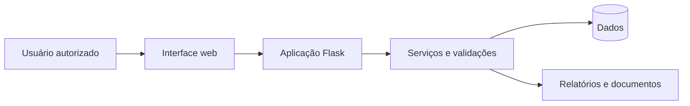

# Arquitetura pública — NUTRIAQUA

Esta é uma visão **conceitual** dos principais componentes, não a documentação interna de produção.

## Tecnologias

- Python e Flask para aplicação web.
- HTML, Jinja2, Bootstrap e JavaScript na interface.
- Pytest para testes automatizados.
- Persistência de dados e geração de relatórios na aplicação.

## Limite da apresentação

O diagrama não documenta topologia, portas internas, domínio de produção, regras de autorização específicas, segredos, infraestrutura de backup ou fluxos sensíveis.
